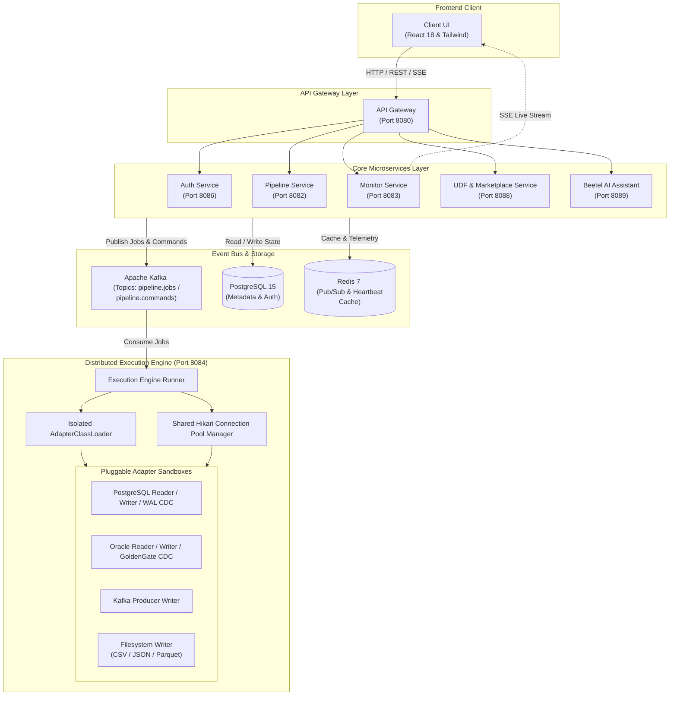

<div align="center">

  # DataShifter

  *Next-generation distributed data migration platform with pluggable adapters and visual DAG orchestration.*

  <p align="center">
    <a href="https://github.com/dharmarajrdr/DataShifter/releases/tag/v0.1.0"></a>
    <a href="https://github.com/dharmarajrdr/DataShifter/actions"></a>
    <a href="https://github.com/dharmarajrdr/DataShifter/blob/main/LICENSE"></a>
    
    
    
    
  </p>

  <p align="center">
    <a href="#-getting-started"><strong>Quick Start</strong></a> •
    <a href="#-architecture"><strong>Architecture</strong></a> •
    <a href="https://github.com/dharmarajrdr/DataShifter/issues/new?template=bug_report.md"><strong>Report Bug</strong></a> •
    <a href="https://github.com/dharmarajrdr/DataShifter/issues/new?template=feature_request.md"><strong>Request Feature</strong></a>
  </p>

</div>

---

**DataShifter** is an enterprise-grade distributed data migration and streaming platform designed for data engineers, DevOps teams, and database administrators. It eliminates pipeline downtime and brittle batch ETL scripts by pairing dynamic, isolated adapter plugins with real-time Change Data Capture (CDC) and an intuitive drag-and-drop DAG workflow orchestrator.

### Why DataShifter?
- **Zero-Downtime Extensibility**: Install, upgrade, or remove data connector JARs on-the-fly without restarting execution clusters.
- **Sub-Second Streaming CDC**: Ingest and replicate transactional delta streams directly from database write-ahead logs.
- **Visual DAG Orchestration**: Design complex multi-stage pipeline sequences with live dependency cycle validation.
- **AI-Powered Diagnostics**: Built-in intelligent assistant (**Beetel**) provides automated error root-cause analysis and remediation.

---

## Features

  #### Pluggable Adapter Marketplace
  - **Dynamic ClassLoader Isolation**: Load custom connector JARs inside secure, sandboxed execution boundaries.
  - **Pre-Built Enterprise Adapters**: Native high-throughput connectors for Oracle, PostgreSQL, Kafka, and Filesystems.
  - **In-App Marketplace Hub**: Discover, install, and download signed adapter artifacts with dependency locking.

  #### Real-Time Streaming CDC
  - **WAL & Log Scraping**: Transactional change-data replication using PostgreSQL WAL and Oracle GoldenGate logs.
  - **Event Segregation & Ordering**: Exactly-once partitioned message queuing backed by Apache Kafka.
  - **Auto Replay & Lag Tracking**: Resume streams from historical LSN/SCN checkpoints with zero data loss.

  #### Visual DAG Workflow Orchestration
  - **Interactive DAG Canvas**: Connect pipelines in series or parallel using a modern drag-and-drop interface.
  - **Topological Cycle Prevention**: Real-time graph inspection catches circular references before execution starts.
  - **Granular Pre-Run Validation**: Node-level schema mapping validation prevents unmapped non-nullable column failures.

  #### Live Operations & Observability
  - **Dual-View Dashboards**: Seamlessly toggle between responsive Grid cards and high-density Table list views.
  - **Throughput & Lag Metrics**: Live metrics dashboards powered by Server-Sent Events (SSE) and Redis Pub/Sub.
  - **Audit Logging & Hub**: Centralized alert channels and role-based access management.

---

## Architecture

DataShifter uses an asynchronous microservices topology orchestrated around Kafka and Redis, decoupling gateway traffic from distributed batch and streaming execution engines.



---

## 🚀 Getting Started

### Prerequisites
Ensure the following tools are installed on your host:
- **Docker Engine** (v24.0+) & **Docker Compose** (v2.20+)
- **Java Development Kit (JDK 17+)**
- **Node.js** (v18+) & **npm** (v9+)
- **Maven** (v3.9+)

### Quick Start (Docker Compose)

1. **Clone the repository**:
   ```bash
   git clone https://github.com/dharmarajrdr/DataShifter.git
   cd DataShifter
   ```

2. **Boot the complete infrastructure & microservices**:
   ```bash
   docker compose -f backend/docker-compose.yml up -d
   ```

3. **Launch the frontend client**:
   ```bash
   cd frontend
   npm install
   npm run start
   ```

4. **Access the application**:
   - Open your browser to `http://localhost:3000`


---

## Tech Stack

| Domain | Technologies |
| :--- | :--- |
| **Frontend** | React 18, Tailwind CSS, React Router v6, React Flow (DAG), KaTeX |
| **Backend Services** | Java 17, Spring Boot 3.2, Spring Cloud Gateway, Hibernate/JPA |
| **Messaging & Events**| Apache Kafka (Event Sourcing), Redis 7 (Pub/Sub, Heartbeats) |
| **Data Stores** | PostgreSQL 15 (Metadata & Auth), Oracle 23c Free (Target/Source) |
| **Adapter Framework**| Custom Isolation ClassLoaders, HikariCP Shared Pools, Bytecode Verification |
| **Testing & CI/CD** | JUnit 5, Mockito, Jest, React Testing Library, GitHub Actions |

---

## Contributing

I welcome contributions from the community! Please read our contributing guide before submitting a pull request:

1. **Fork** the repository and clone your fork.
2. Create a topic branch: `git checkout -b feature/amazing-feature`.
3. Ensure all tests pass:
   - Backend: `mvn clean test`
   - Frontend: `npm test -- --watchAll=false`
4. Commit your changes: `git commit -m "feat: add amazing feature"`.
5. Push to your branch: `git push origin feature/amazing-feature`.
6. Open a **Pull Request** targeting the `develop` branch.

---
